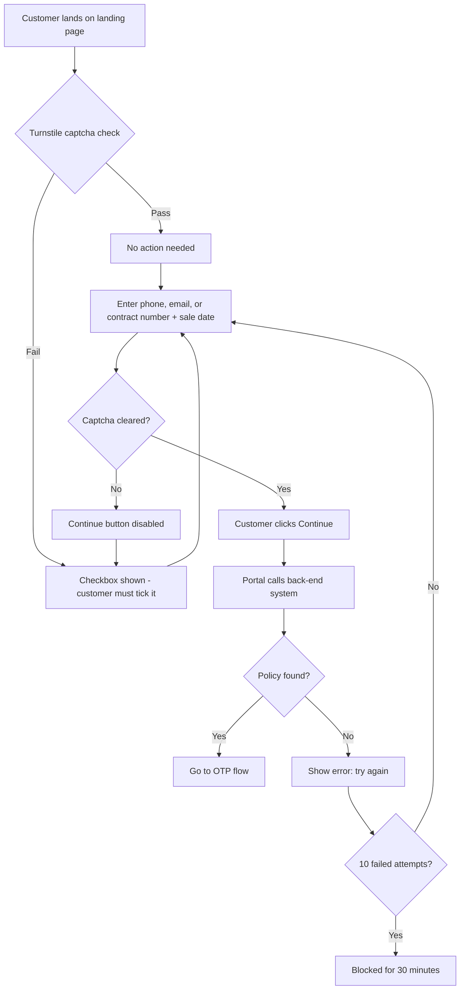

# 1. Policy search

The customer finds their policy.

- **Starts:** customer lands on the landing page.
- **Hands off to:** [2. OTP routing and registration](02-otp-routing.md) when a policy is found.

## Confirmed rules

- The captcha runs automatically. If it fails, the customer must tick a checkbox.
- Continue stays disabled until the captcha is cleared.
- The customer searches by phone, by email, or by contract number + sale date.
- "Contract number" and "certificate number" are the same identifier. These flows use "contract number".
- After 10 failed searches, the customer is blocked for 30 minutes.

## Critical and high risks

| ID | Risk | Severity |
| --- | --- | --- |
| PS-R1 | Captcha and limits may be enforced only in the page, not on the server | High |
| PS-R2 | Full contact details may be returned to the page before verification | High |
| PS-R3 | Policy enumeration through "found" vs "not found" responses | High |
| PS-R4 | Contract number + sale date pairs can be guessed | High |

Full list, with mitigations and every open gap: [Gaps and security risks](https://claude.ai/artifact/ACWnu4fgxAkVrzm26QSBgc).

## Open questions

- Are the captcha and the search limit enforced on the server, and are contacts masked in every response?
- Does the search lockout apply to the device, IP address, or identifier, and when does the attempt counter reset?
