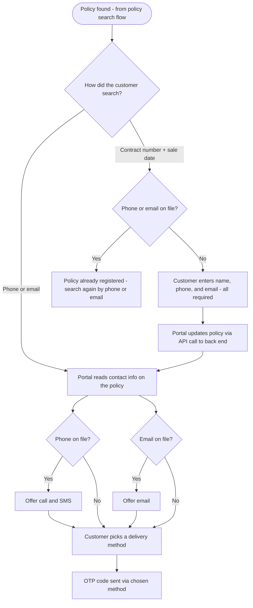

# 2. OTP routing and registration

The customer picks how to receive a one-time code. Unregistered policies get contact details added first.

- **Starts from:** [1. Policy search](01-policy-search.md) when a policy is found.
- **Hands off to:** [3. OTP code verification](03-otp-verification.md) once the code is sent.

## Confirmed rules

- The customer is offered OTP methods based on the contact data on the policy, not on how they searched. A phone on file means call and SMS. An email on file means email.
- The "no contact on file" path happens only for searches by contract number + sale date.
- No contact on file: the customer enters name, phone and email (all required). The portal updates the policy through an API call to the back end, then continues to OTP.
- Phone or email on file: the customer is told the policy is already registered and asked to search again by phone or email (back to [1. Policy search](01-policy-search.md)).
- The policy is updated before OTP verification. This is flagged as a critical risk below.

## Critical and high risks

| ID | Risk | Severity |
| --- | --- | --- |
| RG-R1 | Policy takeover: anyone with a contract number + sale date can attach their own contact details before verifying | Critical |

Full list, with mitigations and every open gap: [Gaps and security risks](https://claude.ai/artifact/ACWnu4fgxAkVrzm26QSBgc).

## Open questions

- Should the policy update move to after OTP verification, and should a second identity check be added on the contract path?
- Are contacts masked in every response, including when the portal reads the contact info on the policy?
- What is the recovery path for customers who can't use the contact details on file?
