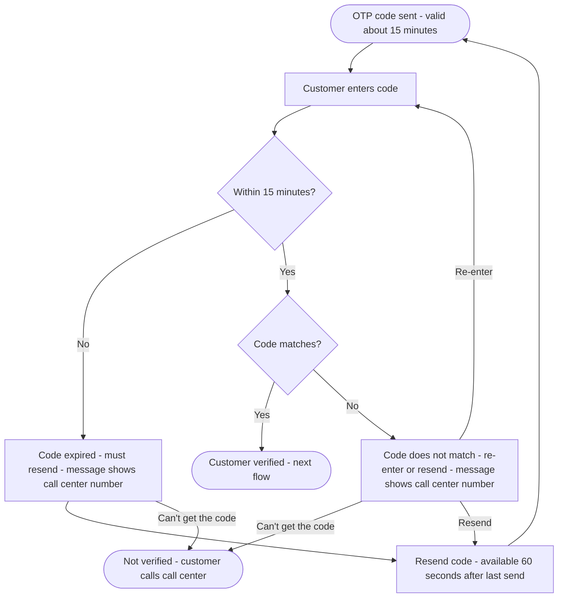

# 3. OTP code verification

The customer enters the one-time code.

- **Starts from:** [2. OTP routing and registration](02-otp-routing.md) once the code is sent.
- **Hands off to:** [4. Policy access after verification](04-policy-access.md) once the customer is verified.
- **Exits to:** the call center when the customer can't get the code.

## Confirmed rules

- A code is valid for about 15 minutes.
- A resend is available 60 seconds after the last send.
- If the code is wrong, the customer is told it doesn't match and can re-enter it or resend.
- A customer who can't get the code (no access to the phone or email it went to) is not verified. They must call the call center. The error and expiration messages give the call center's toll-free number.

## Assumptions not yet confirmed

- An expired code requires a resend.
- A resend creates a new code and cancels the old one.

## Critical and high risks

| ID | Risk | Severity |
| --- | --- | --- |
| OV-R1 | Code guessing: no limit on wrong OTP attempts | Critical |
| OV-R2 | SMS and call toll fraud: no limit on resends | High |

Full list, with mitigations and every open gap: [Gaps and security risks](https://claude.ai/artifact/ACWnu4fgxAkVrzm26QSBgc).

## Open questions

- What are the limits on wrong codes and resends, and what lockout applies?
- Are these limits enforced on the server?
