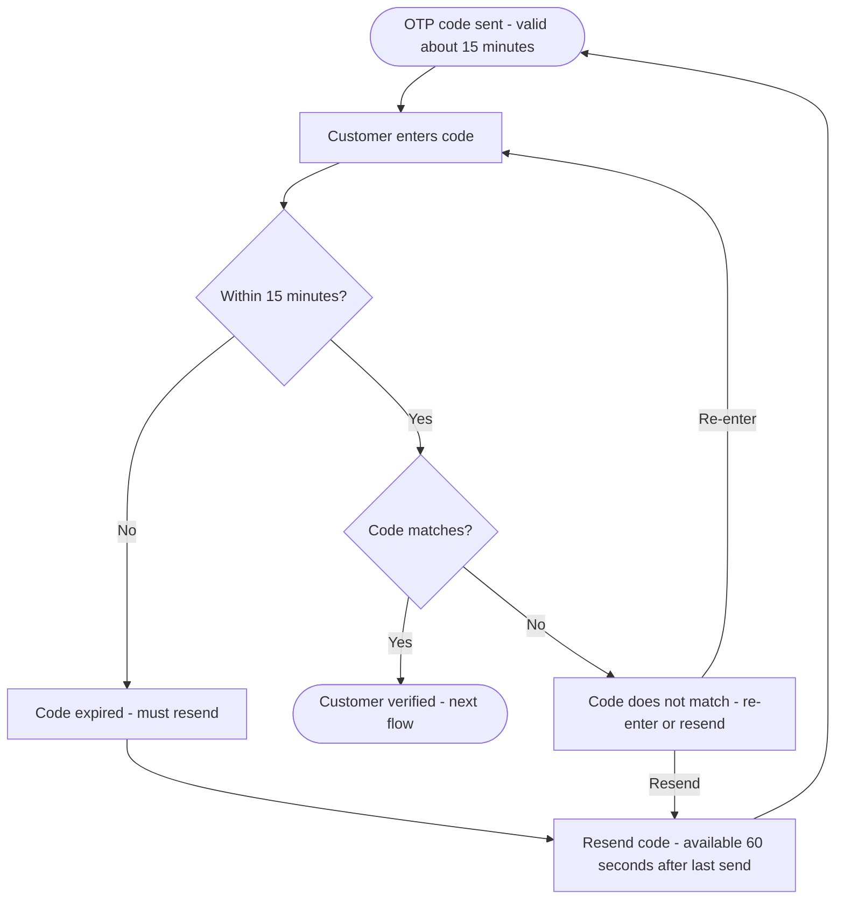

# 3. OTP code verification

The customer enters the one-time code.

- **Starts from:** [2. OTP routing and registration](02-otp-routing.md) once the code is sent.
- **Hands off to:** the next flow after the customer is verified (not yet mapped).

## Confirmed rules

- A code is valid for about 15 minutes.
- A resend is available 60 seconds after the last send.
- If the code is wrong, the customer is told it doesn't match and can re-enter it or resend.

## Assumptions not yet confirmed

- An expired code requires a resend.
- A resend creates a new code and cancels the old one.

## Critical and high risks

| ID | Risk | Severity |
| --- | --- | --- |
| OV-R1 | Code guessing: no limit on wrong OTP attempts | Critical |
| OV-R2 | SMS and call toll fraud: no limit on resends | High |

Full list, with mitigations and every open gap: [Gaps and security risks](https://claude.ai/artifact/ACWnu4fgxAkVrzm26QSBgc).

## Open questions

- What are the limits on wrong codes and resends, and what lockout applies?
- Are these limits enforced on the server?
- What happens after the customer is verified? This is the next flow to map.
