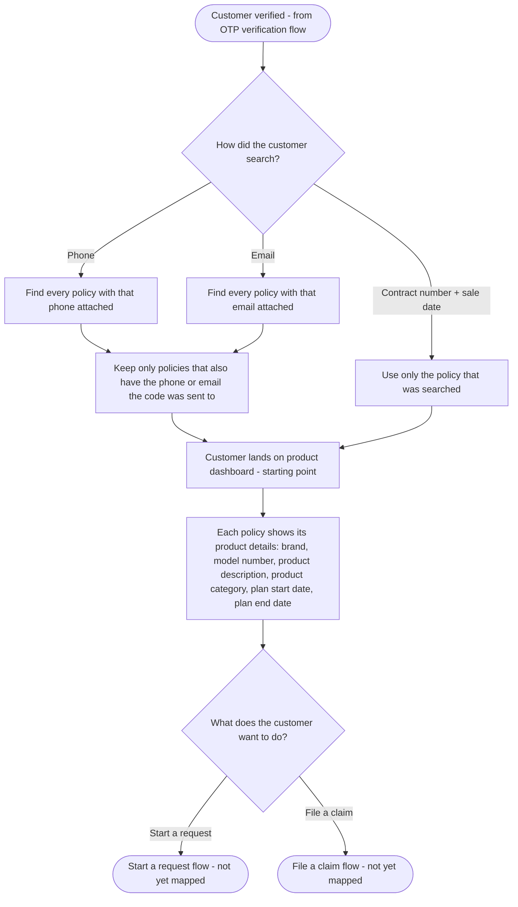

# 4. Policy access after verification

Once verified, the customer lands on the product dashboard. It shows the policies tied to how they searched and the contact they verified. The dashboard is the starting point for intent-based flows, such as starting a request or filing a claim.

- **Starts from:** [3. OTP code verification](03-otp-verification.md) once the customer is verified.
- **Hands off to:** "Start a request" or "File a claim" from the product dashboard (neither mapped yet).

## Confirmed rules

- After OTP verification, the customer lands on the product dashboard.
- A phone search finds every policy that has the phone attached. This can be 1 policy or many.
- An email search works the same way: every policy that has the email attached.
- Policies found by phone can have the same email address or different ones.
- The dashboard shows only policies tied to the phone or email the code was actually sent to.
- A contract number + sale date search shows only that 1 policy, even if the customer's details are on other policies too.
- Each policy shows the product details on it: brand, model number, product description, product category, plan start date and plan end date.
- The dashboard has two calls to action: "Start a request" and "File a Claim". Each starts its own flow.

## Critical and high risks

First pass for this flow.

| ID | Risk | Severity |
| --- | --- | --- |
| PD-R2 | Shared or recycled contacts: a household phone, shared email or reassigned number shows policies that belong to someone else | High |
| PD-R3 | The policy list may be chosen by the page rather than the server, so a verified customer could request policies outside their match | High |

PD-R1 (seeing policies whose contact was never verified) is handled by the rule that the dashboard shows only policies tied to the verified phone or email.

The takeover risk RG-R1 also lands here: anyone who attached their own details through the contract path reaches the dashboard for that policy.

Full list, with mitigations and every open gap: [Gaps and security risks](https://claude.ai/artifact/ACWnu4fgxAkVrzm26QSBgc).

## Open questions

- Are "Start a request" and "File a Claim" shown on each policy, or once for the whole dashboard with the customer picking a policy afterwards?
- Are the CTAs shown for every policy, or only for some, such as policies whose plan end date hasn't passed?
- Are there other intents on the dashboard besides these two?
- Is the policy list built on the server from the verified session alone?
- How long does the verified session last?
