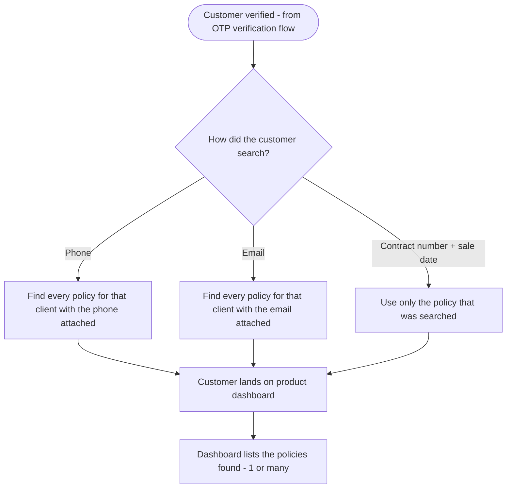

# 4. Product dashboard

Once verified, the customer lands on the product dashboard and sees the policies tied to how they searched.

- **Starts from:** [3. OTP code verification](03-otp-verification.md) once the customer is verified.
- **Hands off to:** not yet mapped (what the customer can do on the dashboard).

## Confirmed rules

- After OTP verification, the customer lands on the product dashboard.
- A phone search shows every policy under that client that has the phone attached. This can be 1 policy or many.
- Those policies can have the same email address or different ones.
- A contract number + sale date search shows only that 1 policy, even if the customer's details are on other policies too.

## Assumptions not yet confirmed

- An email search works the same way as a phone search: every policy under that client with the email attached.

## Critical and high risks

First pass for this flow. These are not in the gaps and security risks doc yet.

| ID | Risk | Severity |
| --- | --- | --- |
| PD-R1 | Verified contact differs from searched contact: a customer searches by phone but verifies with an email code, then sees every policy with that phone, including policies whose email they never proved they control | High |
| PD-R2 | Shared or recycled contacts: a household phone, shared email or reassigned number shows policies that belong to someone else | High |
| PD-R3 | The policy list may be chosen by the page rather than the server, so a verified customer could request policies outside their match | High |

The takeover risk RG-R1 also lands here: anyone who attached their own details through the contract path reaches the dashboard for that policy.

Full list, with mitigations and every open gap: [Gaps and security risks](https://claude.ai/artifact/ACWnu4fgxAkVrzm26QSBgc).

## Open questions

- Does an email search show every policy with that email, the same as a phone search?
- How is "that client" identified? If two different clients share a phone or email, does either see the other's policies?
- Should the dashboard show only policies tied to the contact the customer actually verified (the phone or email the code went to)?
- When a phone search matches several policies with different emails, which emails are offered for the OTP in [2. OTP routing and registration](02-otp-routing.md)?
- Is the policy list built on the server from the verified session alone?
- How long does the verified session last, and what can the customer do from the dashboard? This is the next flow to map.
